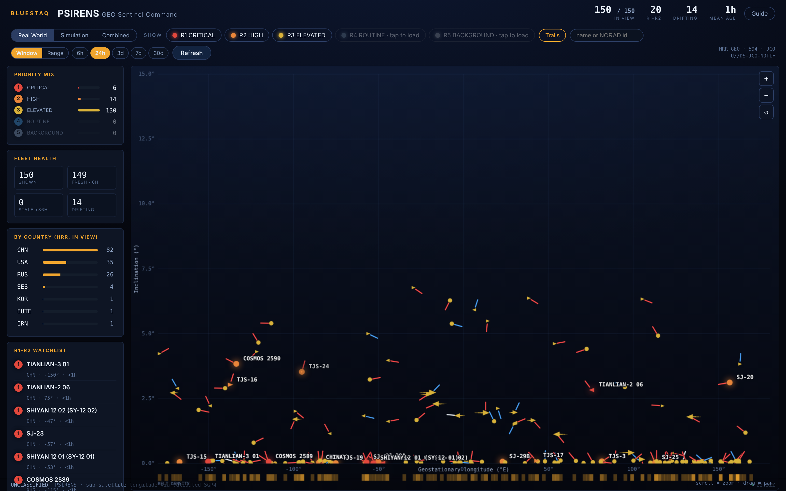
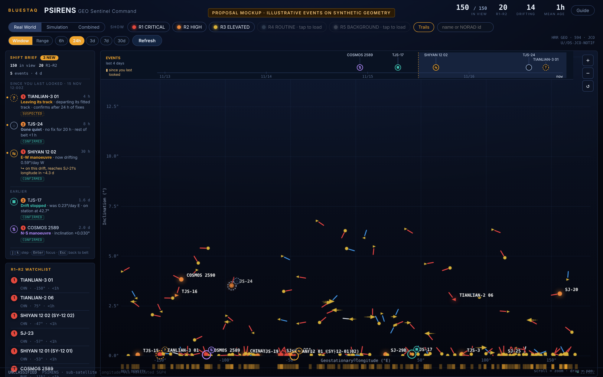
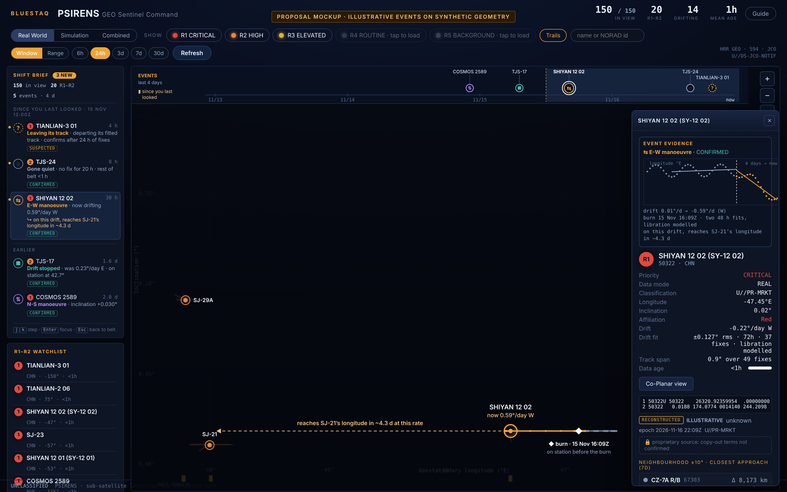

# Change proposal: Shift Brief

PSIRENS 1.7.0 candidate. Proposed 16 November 2026. Status: **PROPOSAL, NOT BUILT.** Nothing in `src/` has changed. Owner decision required before any implementation.

## The decision in one line

Turn PSIRENS from a picture the operator has to search into a picture that tells the operator what changed: detect manoeuvres and silences server-side, list them in a Shift Brief, put them on a timeline, and give every event a one-key focus view with the evidence behind it.

## The problem

Today PSIRENS answers "where is everything?" very well. It does not answer the question an operator walks in with: **"what changed since I last looked?"**

● The default view carries 150 objects at ranks 1 to 3. A manoeuvre shows up only as a slightly different arrowhead, or a trail that bends, somewhere in that field (figure A). Finding it means scanning every marker and remembering what it looked like yesterday.

● The rail spends its space on Priority mix, Fleet health and By-country. Those are stable inventory numbers. They change slowly and rarely prompt an action.

● Silence is invisible. An object that has stopped reporting keeps its last position and simply fades. Nothing says "this one went quiet".

● **A real defect surfaced while building this proposal (FACT, measured on the scenario store).** The inspector reports SHIYAN 12 02 drifting at **0.22°/day W**. Its true post-burn rate is **0.59°/day W**. The 72-hour drift fit straddles the burn, so it averages "on station" with "drifting" and understates the new rate by a factor of 2.7. Any rate taken across a manoeuvre is wrong, and today the interface has no way to know a manoeuvre happened. Event detection is what fixes that number.



*Figure A. The current interface on the guide seed with five events injected. Every one of the five is in this picture. None of them is visible.*

## The change

Three parts, one idea.

### 1. Shift Brief (the rail)

Replaces Priority mix, Fleet health and By-country at the top of the left rail (those move below the watchlist, collapsed). Lists events, newest first, split at **"since you last looked"**:

| Event | Glyph | What triggers it |
|---|---|---|
| E-W manoeuvre | ⇆ | Significant change in fitted drift rate across a split |
| Drift stopped | ■ | Drift rate falls to station-keeping level |
| N-S manoeuvre | ⇅ | Step change in inclination |
| Leaving its track | ? | Latest fixes depart from the fitted prediction (early warning) |
| Gone quiet | ○ | No fix for 12 h. In the build, only while the rest of the belt is current, so a feed outage raises the existing staleness banner instead of 594 separate events (the prototype does not yet have this condition) |

Each entry carries rank, name, event type, age, the numbers that justify it, and a confidence tier:

● **SUSPECTED** (dashed glyph): early warning only, or evidence that peaks at the edge of the data. Never stated as fact.

● **CONFIRMED**: two independent 48-hour fits either side of the split disagree beyond both a physical floor and six standard errors.

Where a drifter is heading towards another high-interest object, the entry says so: "on this drift, reaches SJ-21's longitude in ~4.3 d". That is a projection at constant rate, labelled as one, not a prediction of intent.

### 2. Event timeline (above the plot)

A four-day strip across the top of the plot. One glyph per event, coloured by type, dashed when SUSPECTED, with the "since you last looked" region shaded. Click a glyph to focus that event. It answers "when" at a glance, and shows clusters (several objects moving in the same few hours) that a list hides.



*Figure B. The brief lists five events: three new since the operator last looked, two earlier. Each event is also haloed on the plot with its glyph.*

### 3. Focus mode (the plot and the inspector)

Enter on a brief entry, or a click on a timeline glyph, focuses the event:

● The plot zooms to frame the object and anything relevant (here SJ-21 and SJ-29A), and veils everything else.

● The trail splits at the burn: grey before, amber after, with a ◆ at the burn epoch.

● A dashed projection runs from the object to the nearest relevant neighbour at the current rate.

● The inspector opens with an **Event evidence** block on top: longitude against time across four days, with the two fitted lines drawn and the split marked, plus the numbers (rates before and after, burn epoch, fit method). The operator sees why the system believes it, not just that it does.

● `j` and `k` step through events, `Enter` focuses, `Esc` returns to the belt. A watch officer can work the whole brief without the mouse.



*Figure C. Focus mode. Note the inspector's existing Drift row still reads 0.22°/day W against the evidence block's 0.59°/day W: that is the defect above, left visible on purpose. In the build, the Drift row would fit only the post-event segment and say so.*

## Evidence the detector works

PROTOTYPE, in `prototype/`, built on the shipped `psirens.astro.drift_fit`. Re-run on 16 November 2026 before this proposal was written; every number below is from that run.

**Synthetic belt.** Each object has eccentricity libration at the sidereal period (e from 0.0002 to 0.003), a two-provider longitude bias up to ±0.012°, per-fix scatter of 0.004° to 0.02°, ragged 45 to 90 minute sampling with 30% dropout, and a burn at a random time 36 to 200 hours before the end.

| Test | Result |
|---|---|
| 400 quiet objects, E-W | **0 false events** |
| 400 quiet objects, N-S | **0 false events** |
| E-W rate change 0.02°/day | 18/60 detected (below the floor, by design) |
| E-W rate change 0.05°/day | 56/60, median timing error 3.9 h |
| E-W rate change 0.1°/day | 60/60, 2.2 h |
| E-W rate change 0.3°/day | 60/60, 1.4 h |
| N-S step 0.005° | 1/60 (below the floor, by design) |
| N-S step 0.01° | 59/60 |
| N-S step 0.03° and 0.1° | 60/60 each |
| Early warning, 300 quiet objects × 48 hourly checks | **0 false alarms** |
| Early warning, 1.0°/day burn | 40/40, median 5 h after the burn |
| Early warning, 0.3°/day burn | 37/40, median 8 h |
| Early warning, 0.1°/day burn | 3/40 (these confirm via the main detector after about 24 h instead) |

**Scenario store** (the guide seed, 594 objects, with five events injected by `prototype/scenario.py`): the detectors found **exactly the five, and nothing else**. The mockup is drawn from that output (`prototype/events.json`), not from hand-written data.

| Injected | Detected |
|---|---|
| SHIYAN 12 02, E-W burn 30 h ago, 0.60°/day W | CONFIRMED, burn at 30 h, 0.591°/day W |
| TJS-17, drift 0.25°/day E stopped 40 h ago | CONFIRMED, 39 h, 0.23 to -0.02°/day |
| COSMOS 2589, inclination +0.030°, 58 h ago | CONFIRMED, +0.030°, **timed 10 h late** |
| TIANLIAN-3 01, 1.0°/day E burn 7 h ago | SUSPECTED, alarmed 3 h after the burn |
| TJS-24, no fix for 19 h | Gone quiet, last fix 20 h ago |

**One defect the prototype caught in itself.** The first version CONFIRMED the TIANLIAN-3 01 burn 17 hours early at 0.31°/day, because the evidence peaked at the last split it could test and the "after" window straddled a burn that came later. The fix is the **edge rule**: evidence that peaks at the data edge is demoted to SUSPECTED and never confirmed. That rule is in the prototype and would be a committed test case.

## What this does not prove (read before deciding)

● **The noise model is mine, not UDL's. (INFERENCE.)** The thresholds (E-W floor 0.02°/day, N-S floor 0.008°, six sigma) are tuned against synthetic scatter. Live multi-provider scatter may be wider, and a cross-provider bias that changes when the provider mix changes could look like a step. **Calibration against live data is the first build task, not an afterthought.** The tool for it is the same one that needs a networked workstation: run the detector offline over a copy of the deployed store and count events per day. A real belt should produce a handful, not dozens.

● **N-S timing is coarse.** 10 hours late on the scenario. The inclination detector uses medians over 48-hour windows, which is robust but blunt. Adequate for a brief, not for a timeline you would brief a commander from. Stated in the evidence block.

● **Drifts under about 0.05°/day are not detected.** That is the station-keeping band and is deliberate, but a slow, patient approach will not appear here. The brief must say "no event" means "no detectable event", not "nothing happened".

● **"Since you last looked" is per browser.** Kept in `localStorage` behind try/catch, as the guide's progress already is. Two operators on one workstation share it; a cleared browser shows everything as new. No server state, no user identity, which matters given the open `user.email` question.

● **The projection is arithmetic, not intelligence.** Constant rate to a longitude. It says nothing about intent and the label says so.

## How it would be built

**Server.** A new `events.py` module holding the two detectors and the early-warning test, plus `GET /api/events?view=&ranks=` returning events with their evidence (fit lines, split epoch, rates, tier). Events are computed **once per refresh cycle** in the background thread and cached, never per request. Cost ESTIMATE, extrapolated from the prototype: about 25 ms per object over a ten-day window, so roughly 15 s of background CPU per hourly cycle for 594 objects. Acceptable; incremental re-fit of only objects with new samples would cut it sharply if it is not.

**Drift row fix.** The drift fit in the tracks payload uses only samples after the most recent CONFIRMED E-W event, and the payload says so (`drift_since_event`). This is the defect fix and is worth doing even if the rest is declined.

**SPA.** Shift Brief panel, timeline strip, plot halos, focus mode (veil, split trail, projection), evidence block in the inspector, keyboard steps.

**Guide.** A new section, a recaptured figure set, two new self-check questions and one sandbox drill ("find the object that changed").

**Guards**, in the house pattern, each proven by a deliberate revert:

● Detector tests: zero events across quiet synthetic objects; detection and timing across the burn bands; the TIANLIAN edge case as a committed red case (removing the edge rule must CONFIRM it early and fail).

● API tests: shape, ETag, rank filter, nothing computed per request.

● Layout probe: the brief lists events, `j`/`k` move the selection, Enter focuses (canvas publishes `dataset.focus`), the timeline glyph count matches the brief, Esc restores the full view.

● The drift row: SHIYAN 12 02's scenario rate must read 0.59 after the fix and 0.22 before it.

**Effort, ESTIMATE:** server and tests 1 session; SPA 2 sessions; guide, probe and calibration 1 session. Four sessions, plus the live calibration run, which needs Ash's networked workstation.

**Release order.** The Logging standard (blocking from 1 December 2026) comes first. This is 1.7.0 after it, not instead of it.

## Decisions for Ash

1. **Go or no-go** on the Shift Brief as described.
2. **Rail space**: replace Priority mix, Fleet health and By-country at the top (proposed), or add the brief above them and accept a longer rail.
3. **Thresholds**: accept the prototype floors (0.02°/day E-W, 0.008° N-S, gone quiet at 12 h) as the starting point pending live calibration, or name your own.
4. **The drift row fix**: ship it alone ahead of the rest if the rest is declined or deferred. Recommended either way: it is a wrong number on the screen today.

## Reproducing this

```
# from a scratch directory, with the project venv
python prototype/detect.py                          # synthetic sensitivity and false-positive run
python prototype/early.py prototype                 # early-warning latency and false alarms
python prototype/scenario.py <seed-dir> <out-dir>   # inject the five events into a guide seed
python prototype/events.py prototype <out-dir>/history.json <seed-dir>/hrr.json events.json
node prototype/mock.js <app-url> <out-dir> events.json <out-dir>/history.json <seed-dir>/hrr.json
```

The guide seed comes from `tools/guide_seed.py`. `mock.js` drives the real 1.6.22 interface and paints the proposed elements over it; everything under the paint is the shipped application. The mockup banner says "illustrative events on synthetic geometry", and it means it.
